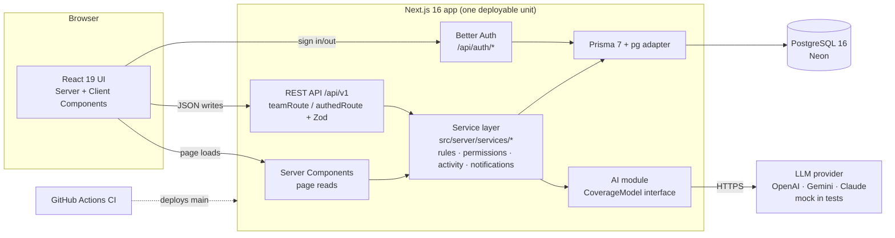

# Architecture contract

StudyCrew is a **layered modular monolith**: one Next.js 16 app, deployed as one unit on Vercel, backed by one Neon
Postgres database. This matches proposal Figure 1 and the Architecture lecture's ADR ("small student team, shared
transactions → modular monolith; microservices rejected because of distributed failure modes").



## Layers and what may call what

| Layer | Folder | May import | Must not |
|---|---|---|---|
| Pages / layouts (Server Components) | `src/app/(app)/**/page.tsx` | services, contracts, components, `requirePageUser` | `db`, Prisma types, business rules |
| Client Components | `src/components/features/<feature>/**` | contracts (types), `apiFetch`, `useApiAction`, UI kit | anything in `src/server` except `import type` |
| Route handlers | `src/app/api/v1/**/route.ts` | `teamRoute`/`authedRoute`, `parseBody`/`parseQuery`, services, contracts | `db`, business rules |
| Services | `src/server/services/<feature>/` | `db`, permissions, activity, notifications, mappers, contracts, other services' exported functions | React, `next/navigation` |
| Shared server core | `src/server/*.ts`, `src/server/shared/` | `db` | feature services |
| Contracts | `src/contracts/*.ts` | `zod` | everything else (they're imported by client and server) |

ESLint blocks `db`/`PrismaClient` imports outside `src/server/**`, `prisma/**`, and `tests/**`.

## Rendering model

- `cacheComponents` is **off** (see `next.config.ts`). Every page under `(app)/` is dynamic and server-rendered per
  request with the session. Don't add `"use cache"`.
- **Reads:** pages call services directly. **Writes:** Client Components call `/api/v1` with `apiFetch`, then
  `useApiAction` calls `router.refresh()` so the Server Components re-read. Don't use Server Actions (keeps one write
  path that is tested by route tests and the authorization sweep).
- TanStack Query is available for client-side polling only (e.g. the notification badge). No global client cache.
- The `(app)/layout.tsx` requires a session; `teams/[teamId]/layout.tsx` blocks non-members and renders the team tabs.
  Your team page does not need to re-check membership for display, but **services always check** (defense in depth).

## Request lifecycle (write)

```mermaid
sequenceDiagram
  participant C as Client component
  participant R as Route (teamRoute)
  participant S as Service
  participant DB as Postgres
  C->>R: POST /api/v1/teams/:teamId/tasks {json}
  R->>R: requireUser() → 401 if signed out
  R->>DB: requireMembership(teamId) → 403 / 404
  R->>R: parseBody(createTaskInput) → 400 with field errors
  R->>S: createTask(teamId, userId, input)
  S->>DB: BEGIN; insert task; logActivity; notify; COMMIT
  S-->>R: TaskDTO
  R-->>C: 201 { data: TaskDTO }
  C->>C: toast + router.refresh()
```

## API conventions

- Base path `/api/v1`. JSON in, JSON out. Success: `{ "data": … }` (200; 201 for creates via `created()`).
  Error: `{ "error": { "code", "message", "details?" } }` with `details.fields` for validation errors.
- Codes → status: `UNAUTHENTICATED 401`, `FORBIDDEN 403`, `NOT_FOUND 404`, `VALIDATION 400`, `CONFLICT 409`,
  `RATE_LIMITED 429`, `UPSTREAM 502`, `INTERNAL 500`.
- Team data: `/api/v1/teams/[teamId]/<collection>[/[id][/<action>]]`. Current user: `/api/v1/me/...`.
  Actions that a non-member performs (join requests, accepting invites, joining by link) are deliberately **outside**
  `teams/[teamId]` — see `api.md`.
- Use `GET` list, `POST` create/action, `PATCH` partial update, `PUT` idempotent set (RSVP, availability, rating),
  `DELETE` remove. Lists return arrays unless the contract says `Page<T>` (cursor pagination).

## Data and time

- Store UTC (`timestamptz`). DTOs carry ISO strings. Render with `src/lib/dates.ts` in the **viewer's** timezone
  (`SessionUser.timezone`). Availability slots are in **each user's own** timezone (see `contracts/availability.ts`);
  the meeting finder converts with `@date-fns/tz` and must handle DST (US clocks change **Sun Nov 1, 2026**).
- Ids are strings. Never trust an id from the client without checking it belongs to the team.

## Security (NFR-02)

- Better Auth stores salted password hashes; session cookies are HttpOnly, SameSite=Lax, Secure in production.
- Every team-scoped route goes through `teamRoute()`; leader-only actions use `{ leaderOnly: true }` or
  `requireLeader()` in the service.
- Coursework text is sent to the AI provider **only** when a member clicks Run with the consent box checked
  (`runCoverageInput.consent`). Reports can be permanently deleted by their author or a leader.
- Never log request bodies, drafts, or tokens. Never expose another user's timezone/bio to non-teammates.

## Folder map (who owns what is in `docs/process/ownership.md`)

```
prisma/                 schema (frozen), migrations, seed
src/contracts/          Zod inputs + DTO types (frozen)
src/server/             db, auth, session, http, errors, permissions, activity, notifications, mappers (frozen)
src/server/shared/      cross-feature read helpers (frozen)
src/server/services/X/  one folder per feature (owned)
src/server/ai/          CoverageModel interface + mock (PB-10 owns from now on)
src/app/api/v1/…        route handlers (owned per path)
src/app/(app)/…         pages (owned per path; placeholders show the owner)
src/components/ui/      design-system primitives (frozen)
src/components/app-shell/ sidebar, nav, tabs (frozen — every screen is already linked)
src/components/features/X/ feature components (owned); slot components keep their export names
tests/unit|integration/ vitest; tests/helpers (frozen)
cypress/e2e/            one spec per feature (owned)
docs/                   contracts, tasks, process, ai-log
```

## Architecture decision records

| ADR | Decision | Alternatives | Why | Revisit if |
|---|---|---|---|---|
| 1 | Modular monolith, one deploy | Microservices; separate API server | One team, shared transactions (task + activity + notification commit together), free tier hosting | Independent scaling needed |
| 2 | REST `/api/v1` for writes, RSC for reads | Server Actions; tRPC; GraphQL | One testable write path; the authorization sweep can enumerate routes; matches proposal | — |
| 3 | Full schema up front, frozen | Each feature adds its own migration | Four parallel branches would conflict on migrations | A missing field is found (contract request) |
| 4 | `CoverageModel` interface + mock | Call OpenAI directly from the service | Swappable providers, deterministic tests, no API cost in CI | — |
| 5 | Lazy due-soon notifications (generated on read) | Cron job | Vercel Hobby cron is daily only; lazy generation is exact and free | Email/push added |
| 6 | `cacheComponents` off | Cache Components + Suspense everywhere | Every page is per-user; simpler for parallel work | Performance targets missed |
