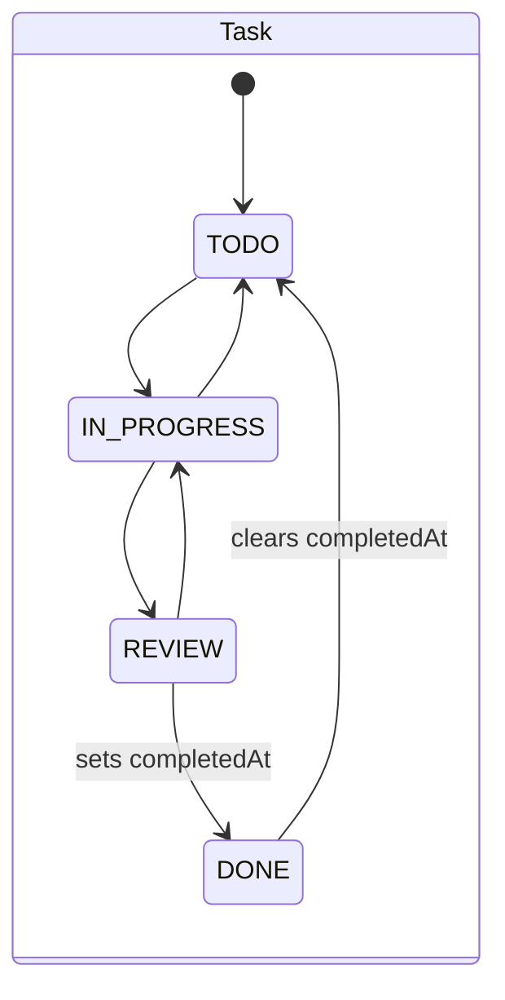
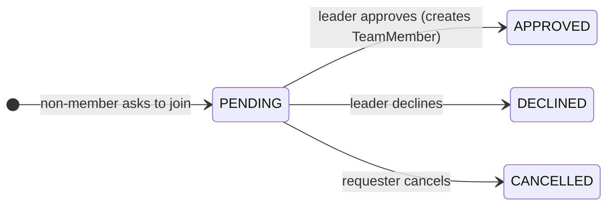

# Data model contract

Source of truth: `prisma/schema.prisma` (frozen — every table for PB-01…PB-17 already exists). This page explains the
relationships and the invariants services must enforce. Report §4 uses this ER diagram.

```mermaid
erDiagram
  User ||--o| Availability : "paints"
  User ||--o{ TeamMember : "belongs via"
  Team ||--o{ TeamMember : "has"
  Team ||--o{ TeamInvite : "sends"
  Team ||--o{ JoinRequest : "receives"
  User ||--o{ JoinRequest : "requests"
  Team ||--o{ Task : "owns"
  Task ||--o{ TaskAssignee : "assigned to"
  User ||--o{ TaskAssignee : "works on"
  Team ||--o{ Milestone : "plans"
  Milestone |o--o{ Task : "groups"
  Team ||--o{ Meeting : "schedules"
  Meeting ||--o{ MeetingRsvp : "gets"
  Meeting ||--o{ AgendaItem : "has"
  AgendaItem ||--o{ AgendaHelpFlag : "flagged by"
  Team ||--o{ Resource : "shares"
  User ||--o{ Notification : "receives"
  Team ||--o{ ActivityEvent : "records"
  Team ||--o{ Poll : "runs"
  Poll ||--o{ PollOption : "offers"
  Poll ||--o{ PollVote : "collects"
  Team ||--o{ CoverageReport : "checks"
  CoverageReport ||--o{ CoverageItem : "lists"
  CoverageItem |o--o| Task : "becomes"

  User { string id PK; string email UK; string timezone; string[] courses; string[] skills }
  Team { string id PK; string courseCode; string inviteCode UK; bool isOpen }
  TeamMember { string teamId PK,FK; string userId PK,FK; enum role }
  Task { string id PK; string teamId FK; enum status; enum priority; datetime dueAt; float position; string milestoneId FK }
  Meeting { string id PK; string teamId FK; datetime startsAt; datetime endsAt }
  CoverageReport { string id PK; string teamId FK; string authorId FK; enum status; int score }
  CoverageItem { string id PK; string reportId FK; enum status; string evidenceQuote; bool evidenceVerified; string taskId UK }
```

## Invariants (enforce in services; test them)

| Entity | Invariant | Enforced by |
|---|---|---|
| Team | ≥ 1 LEADER at all times; ≤ `MAX_TEAM_SIZE` (8) members | PB-04 service |
| JoinRequest | at most one PENDING per (team, user); not allowed for members or closed teams | PB-04 service |
| TeamInvite | pending = `acceptedAt` and `revokedAt` null and `expiresAt` > now | PB-04 service |
| Task | assignees are team members; `completedAt` set iff status = DONE; positions strictly increase within a column | PB-05 service |
| Meeting | `endsAt` > `startsAt`, ≤ 8 h (contract refine); only creator or leader edits/deletes | PB-06 service |
| Availability | slots unique, sorted, 0…335, in the user's timezone | PB-03 service |
| Resource | LINK/FILE_REF have an http(s) `url`; NOTE has `body` | contract + PB-07 service |
| Notification | (userId, dedupeKey) unique | DB unique index + `notify()` |
| ActivityEvent | append-only; written only via `logActivity()` | convention + review |
| CoverageReport | ≤ 10 runs per author per UTC day; `score` null iff FAILED | PB-10 service |
| CoverageItem | `evidenceVerified` = quote appears word-for-word in the draft (whitespace/quote-normalized); unverified COVERED is downgraded to PARTIAL | PB-10 service |
| PollVote | one per (poll, user), changeable until close; no votes after `closesAt` | DB PK + PB-14 service |

## Lifecycles



Any column-to-column move is allowed (it's a board), but entering DONE sets `completedAt` and logs `TASK_COMPLETED`;
leaving DONE clears it.



## Ownership of writes

See `docs/process/ownership.md`. Example: only PB-05 code writes `task`/`task_assignee`; PB-11 creates tasks by calling
PB-05's exported `createTask()`.
